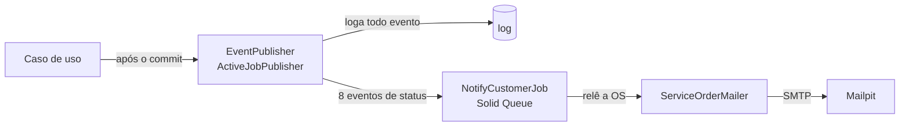
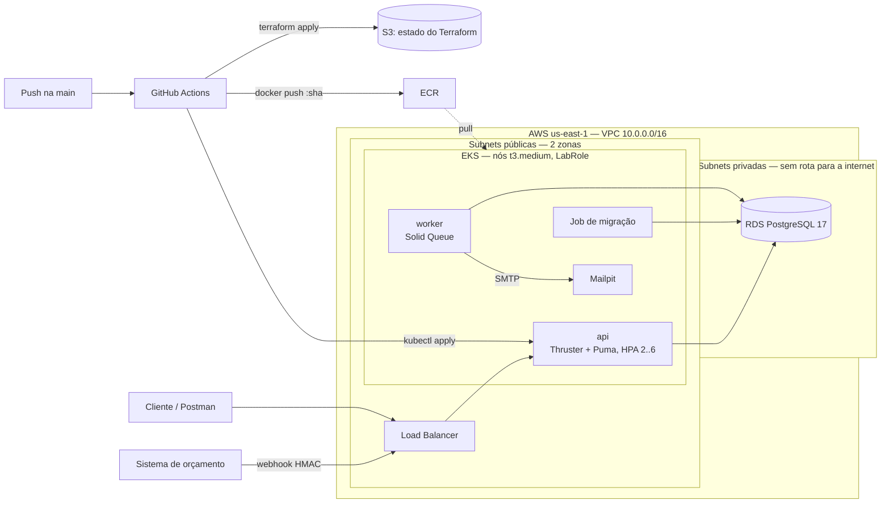
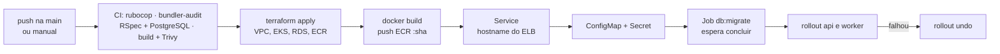

# Sistema Integrado de Atendimento e Execução de Serviços

MVP do back-end de uma oficina mecânica de médio porte — gestão de ordens de
serviço, clientes, veículos, serviços e estoque de peças — construído com
**Domain-Driven Design** sobre um monolito Rails em arquitetura de camadas.

Tech Challenge — Fases 1 e 2, 15SOAT / FIAP Pós-Tech.

> **Idioma:** o código-fonte é escrito em inglês; a documentação e a linguagem
> exibida ao usuário (rótulos de status, mensagens de negócio) permanecem em
> português. O glossário PT↔EN da linguagem ubíqua está em
> [Linguagem ubíqua](#linguagem-ubíqua).

---

## Fase 2: objetivos e onde cada um está

A Fase 1 entregou o domínio. A Fase 2 leva a aplicação para a nuvem com
qualidade de produção: Clean Architecture explícita, as APIs que faltavam para
o atendimento, notificação do cliente por e-mail, e a esteira completa —
contêiner, Kubernetes com escalonamento automático, infraestrutura como código
e CI/CD.

| Requisito | Onde está |
| --- | --- |
| Clean Code e Clean Architecture | [Arquitetura](#arquitetura): casos de uso com Input/Output Ports, composition root, presenters, ports de transação e eventos |
| Testes dos fluxos críticos | 280 exemplos, 97,7% de linha / 83,3% de ramo; rodam no CI contra PostgreSQL 17 |
| Abertura de OS completa (cliente, veículo, serviços e peças) | `POST /service_orders` — cria o que faltar, tudo ou nada |
| Consulta de status | `GET /service_orders/:id/status` (autenticada) e `GET /tracking/:number` (cliente) |
| Aprovação do orçamento por sistema externo | `POST /webhooks/quote_decisions` — assinado com HMAC, idempotente |
| Listagem priorizada | `GET /service_orders` — Em execução > Aguardando aprovação > Em diagnóstico > Recebida, mais antigas primeiro, sem as encerradas |
| Atualização de status por e-mail | [Notificação por e-mail](#notificação-por-e-mail): eventos de domínio → Solid Queue → Mailpit |
| Dockerfile e docker-compose | API, worker, PostgreSQL e Mailpit — [Como rodar](#como-rodar) |
| Kubernetes (Deployment, Service, ConfigMap, Secret, HPA) | [`k8s/`](k8s) — [Kubernetes](#kubernetes) |
| Terraform (cluster e banco) | [`infra/`](infra) — EKS + RDS na AWS — [Terraform](#terraform) |
| CI/CD (build, testes, imagem, deploy do app e do banco) | [`.github/workflows/`](.github/workflows) — [CI/CD](#cicd) |
| Collection das APIs | Swagger gerado pelos testes + [collection do Postman](postman/oficina-api.postman_collection.json) |

---

## Como rodar

Pré-requisitos: Docker e Docker Compose. Nada mais precisa estar instalado.

```bash
git clone <url-do-repositorio> && cd workshop_ddd_api
docker compose up --build
```

Isso sobe PostgreSQL, a API, o worker de jobs (Solid Queue, `bin/jobs`) e o
Mailpit, que recebe os e-mails enviados aos clientes. Em desenvolvimento o banco
é criado e migrado automaticamente na subida (`bin/docker-entrypoint`); em
produção não: lá a migração roda uma vez, como Job do Kubernetes.

Para popular com dados de demonstração:

```bash
docker compose exec api bin/rails db:seed
```

| Recurso            | URL                                |
| ------------------ | ---------------------------------- |
| API                | http://localhost:3000/api/v1       |
| Swagger UI         | http://localhost:3000/api-docs     |
| Health check       | http://localhost:3000/up           |
| E-mails (Mailpit)  | http://localhost:8025              |

Usuários criados pelo seed (senha `oficina123`, configurável via `SEED_PASSWORD`):

| E-mail                    | Papel        |
| ------------------------- | ------------ |
| `gerente@oficina.local`   | `manager`    |
| `atendente@oficina.local` | `front_desk` |
| `mecanico@oficina.local`  | `mechanic`   |

### Primeira chamada

```bash
# 1. Autentique-se e guarde o token
TOKEN=$(curl -s -X POST http://localhost:3000/api/v1/session \
  -H 'Content-Type: application/json' \
  -d '{"email":"gerente@oficina.local","password":"oficina123"}' \
  | ruby -rjson -e 'puts JSON.parse(STDIN.read)["token"]')

# 2. Use o token nas rotas administrativas
curl -s http://localhost:3000/api/v1/customers -H "Authorization: Bearer $TOKEN"

# 3. Abra uma OS completa: cliente e veículo são criados se ainda não existem
curl -s -X POST http://localhost:3000/api/v1/service_orders \
  -H "Authorization: Bearer $TOKEN" -H 'Content-Type: application/json' \
  -d '{"service_order":{
        "customer":{"tax_id":"390.533.447-05","name":"Ana Lima","email":"ana@exemplo.com"},
        "vehicle":{"plate":"BRA2E19","make":"Fiat","model":"Argo","year":2021},
        "services":[{"service_id":1}],
        "parts":[{"part_id":1,"quantity":2}]}}'

# 4. O e-mail "Recebemos seu veículo..." aparece em http://localhost:8025
```

### Rodando sem Docker

Requer Ruby 3.3.13 e um PostgreSQL acessível.

```bash
bundle install
bin/rails db:prepare db:seed
bin/rails server   # API
bin/jobs           # worker que envia os e-mails (SMTP em localhost:1025)
```

---

## Comandos de desenvolvimento

```bash
bundle exec rspec                        # suíte completa + relatório de cobertura
bundle exec rspec spec/domain            # só o domínio (sem banco, ~0.1s)
bundle exec rspec spec/domain/workshop/service_order_spec.rb:68   # um exemplo

bundle exec rubocop                      # lint (rubocop-rails-omakase)
bundle exec rubocop -a                   # lint com autocorreção

bin/security-scan                        # Brakeman + bundler-audit -> tmp/security/
bundle exec rake rswag:specs:swaggerize  # regenera swagger/v1/swagger.yaml
```

Dentro do Docker, prefixe com `docker compose exec api`.

---

## Arquitetura

Monolito em **quatro camadas**, com a regra de dependência apontando sempre para
dentro: o domínio não conhece ninguém.

```
                     ┌──────────────────────────────────────────┐
   HTTP  ──────────► │  Interface        app/controllers        │
                     │  Traduz HTTP ↔ caso de uso. Sem regra.   │
                     └────────────────────┬─────────────────────┘
                                          │
                     ┌────────────────────▼─────────────────────┐
                     │  Aplicação        app/layers/application │
                     │  Orquestra: busca agregado, comanda,     │
                     │  persiste, devolve Result. Sem regra.    │
                     └────────────────────┬─────────────────────┘
                                          │
                     ┌────────────────────▼─────────────────────┐
                     │  Domínio          app/layers/domain      │
                     │  O coração. Entidades, objetos de valor, │
                     │  agregados, eventos. Zero Rails aqui.    │
                     └────────────────────▲─────────────────────┘
                                          │ implementa as portas
                     ┌────────────────────┴─────────────────────┐
   PostgreSQL ◄──────│  Infraestrutura  app/layers/infrastructure│
                     │  ActiveRecord, JWT, adaptadores.         │
                     └──────────────────────────────────────────┘
```

O domínio define **portas** (`Domain::Registry::CustomerRepository`) e a
infraestrutura fornece os **adaptadores**
(`Infrastructure::Persistence::Repositories::CustomersInActiveRecord`). Por isso
os testes de domínio rodam sem banco nenhum — e trocar o ActiveRecord não
encostaria em uma linha de regra de negócio.

### Clean Architecture

As quatro camadas são os círculos da Clean Architecture, com as portas da
Arquitetura Hexagonal nas fronteiras:

| Círculo | No código |
| --- | --- |
| Entidades (regras corporativas) | `app/layers/domain` — agregados, objetos de valor, eventos e as **portas** de repositório |
| Casos de uso (regras da aplicação) | `app/layers/application` — um `UseCase` por comando de negócio, devolvendo `Result` |
| Adaptadores de interface | `app/controllers` (entrada), `app/presenters` (saída HTTP), adaptadores de repositório e de eventos |
| Frameworks e drivers | Rails, ActiveRecord, PostgreSQL, Solid Queue, Action Mailer |

O que garante a regra de dependência na prática:

- **Input Port e Output Port.** Um caso de uso recebe as dependências no
  construtor e a entrada no `#call`; as palavras-chave do `#call` são o Input
  Port e o `Result` é o Output Port:
  `ApproveQuote.new(orders:, parts:, transaction:, events:).call(id: 42)`.
- **Um único composition root.** `Infrastructure::Container` é o único lugar que
  conhece as classes concretas. Controllers pedem o caso de uso pronto
  (`container.approve_quote.call(id: params[:id])`) e os testes usam o mesmo
  container.
- **Transação e eventos também são portas.** Os casos de uso abrem transação por
  `TransactionManager#within` e publicam eventos por `EventPublisher#publish` —
  sem `ActiveRecord::` nem `Rails.` dentro de Domínio e Aplicação (há um `grep`
  que verifica isso).
- **Controllers não montam JSON.** Os presenters em `app/presenters/api/v1` são o
  contrato HTTP; o do acompanhamento público é, além disso, uma fronteira de
  segurança.

### Notificação por e-mail

O cliente recebe um e-mail a cada mudança de status, e isso sai dos eventos de
domínio que os agregados já registravam:



- A fila é o **Solid Queue no próprio PostgreSQL** (sem Redis): o job entra na
  mesma transação, então uma operação desfeita nunca manda e-mail.
- O job leva só o nome do evento e o id da OS e relê a OS ao rodar, para
  descrevê-la como ela está.
- Cliente sem e-mail não é erro: o job registra no log e termina.
- O e-mail diz o que aconteceu, o status atual e o link de acompanhamento; só o
  do orçamento traz o valor. Placa e diagnóstico ficam de fora da caixa de
  entrada.

### Contextos delimitados

| Contexto        | Tipo de subdomínio | Agregados                  |
| --------------- | ------------------ | -------------------------- |
| **Workshop**    | **Principal**      | `ServiceOrder`             |
| Registry        | Suporte            | `Customer`, `Vehicle`      |
| Catalog         | Suporte            | `Service`                  |
| Inventory       | Suporte            | `Part`                     |
| Identity        | Genérico           | `User`                     |

O investimento em DDD tático é proporcional: `ServiceOrder` recebe agregado
completo, objetos de valor, máquina de estados e eventos de domínio; `Part`
também é um agregado de verdade, porque o ciclo de estoque de duas fases
(reserva → baixa → liberação) tem invariantes a proteger; os demais contextos de
suporte ficam mais enxutos, porque padronizar um CRUD com sete camadas seria
cerimônia sem retorno.

### O agregado ServiceOrder

O ciclo de vida da OS vive em `Domain::Workshop::OrderStatus`, e as transições
só acontecem por **comandos de negócio**:

```
received ──► in_diagnosis ──► awaiting_approval ──┬──► in_progress ──► completed ──► delivered
                                                  │
                                                  └──► cancelled
```

Não existe endpoint que escreva `status` diretamente. A OS muda de estado porque
alguém executou uma ação real no pátio (`POST /service_orders/:id/approve_quote`),
e o agregado decide se aquilo é legítimo. É assim que a "alteração automática dos
status conforme ações no sistema" fica garantida por construção, e não por
disciplina de quem chama a API.

---

## Linguagem ubíqua

O negócio fala português; o código, inglês. O mapeamento é explícito e único:

| Negócio (PT)          | Código (EN)      | Onde vive                              |
| --------------------- | ---------------- | -------------------------------------- |
| Ordem de Serviço (OS) | `ServiceOrder`   | `Domain::Workshop` — agregado raiz     |
| Orçamento             | `Quote`          | `Domain::Workshop` — objeto de valor   |
| Diagnóstico           | `diagnosis`      | atributo de `ServiceOrder`             |
| Cliente               | `Customer`       | `Domain::Registry`                     |
| Veículo               | `Vehicle`        | `Domain::Registry`                     |
| CPF / CNPJ            | `TaxId`          | `Domain::Registry` — objeto de valor   |
| Placa                 | `LicensePlate`   | `Domain::Registry` — objeto de valor   |
| Serviço (catálogo)    | `Service`        | `Domain::Catalog`                      |
| Peça / Insumo         | `Part`           | `Domain::Inventory`                    |
| Estoque em mãos       | `quantity_on_hand` | atributo de `Part`                   |
| Estoque reservado     | `quantity_reserved` | atributo de `Part`                  |
| Saldo disponível      | `available_quantity` | consulta de `Part` (mãos − reservado) |
| Reserva de estoque    | `reserve!` / `StockReserved` | comando/evento de `Part` (peça entra na OS) |
| Baixa de estoque      | `consume_reserved!` / `StockDeducted` | comando/evento de `Part` (aprovação) |
| Liberação de reserva  | `release!` / `StockReleased` | comando/evento de `Part` (reprovação / cancelamento) |
| Entrada de estoque    | `restock!` / `StockReplenished` | comando/evento de `Part` (fornecedor) |
| Estoque insuficiente  | `InsufficientStockDetected` | evento de `Part`                |
| Reabastecimento solicitado | `ReplenishmentRequested` | evento de `Part` (na travessia do mínimo) |
| Usuário / Papel       | `User` / `role`  | `Domain::Identity`                     |

Status da OS: `received` (Recebida), `in_diagnosis` (Em diagnóstico),
`awaiting_approval` (Aguardando aprovação), `in_progress` (Em execução),
`completed` (Finalizada), `delivered` (Entregue), `cancelled` (Cancelada).
Os rótulos em português vivem em `OrderStatus::LABELS` e são o que aparece na
tela e nas mensagens de erro.

---

## Escolha do banco de dados: PostgreSQL

O desafio pede a justificativa. São quatro razões, em ordem de peso:

1. **Transações ACID.** Cada movimento de estoque cruza dois contextos numa só
   transação: adicionar peça reserva *e* grava o item da OS; aprovar baixa o
   reservado *e* muda o status; reprovar/cancelar libera a reserva *e* muda o
   status. Sem atomicidade a oficina promete peça que não tem. É o requisito que
   elimina a maioria das alternativas NoSQL.
2. **O modelo é genuinamente relacional.** Cliente 1-N Veículo 1-N OS N-N Peça.
   Modelar isso como documentos exigiria duplicar dados e reconciliá-los à mão.
3. **Compatibilidade de primeira classe com a stack Rails.** O Active Record
   trata PostgreSQL como cidadão de primeira classe: `SELECT ... FOR UPDATE`
   para o lock da aprovação, CHECK constraints e chaves estrangeiras expressos
   direto na migração, e o mesmo adaptador em desenvolvimento, teste e produção
   — sem a divergência entre um SQLite local e o Postgres de produção que
   costuma esconder bug até o deploy.
4. **`bigint` para dinheiro.** Todo valor monetário é guardado em centavos
   (`Domain::Shared::Money`). Nenhum float encosta em um orçamento que o cliente
   aprovou juridicamente.

---

## Testes e cobertura

```bash
bundle exec rspec
```

A suíte é dividida por camada, e a divisão importa:

- `spec/domain/` — POROs puros. Sem banco, sem HTTP, sem fixtures. Roda em
  milissegundos e é onde mora a maior parte das asserções de regra de negócio.
- `spec/application/` — casos de uso. Os simples contra um repositório falso em
  memória; os que cruzam dois contextos numa transação (`ApproveQuote`,
  `AddPartToOrder`, `RejectQuote`, `CancelServiceOrder`) contra PostgreSQL real,
  porque um repositório falso não prova que o rollback desfez as duas metades.
- `spec/infrastructure/` — adaptadores de porta contra o banco, incluindo o
  publicador de eventos (que eventos viram e-mail, e que nada é enfileirado
  quando a operação é desfeita).
- `spec/jobs/` e `spec/mailers/` — o envio do e-mail e o seu conteúdo.
- `spec/requests/` — integração de verdade (controller → caso de uso →
  repositório → PostgreSQL), escrita no DSL do **rswag**.

O gate de cobertura está em `spec/rails_helper.rb`: **mínimo de 80% de linha** —
o exigido pela Fase 1 — mais 70% de branch. Hoje: 280 exemplos, 97,7% de linha e
83,3% de branch. O relatório separa as camadas, então dá para verificar a
cobertura do domínio crítico isoladamente em `coverage/index.html`. No CI a
suíte roda contra PostgreSQL 17 com `eager_load` ligado.

---

## Documentação da API (Swagger)

A documentação **é gerada a partir dos testes de integração**, não escrita à
parte. Isso resolve o problema clássico da documentação de API: ela não pode
divergir do comportamento real, porque se divergir o teste quebra.

```bash
bundle exec rake rswag:specs:swaggerize   # regenera swagger/v1/swagger.yaml
```

A UI fica em http://localhost:3000/api-docs. Um endpoint novo não é considerado
pronto até ter um spec em `spec/requests/` — é o spec que o documenta.

### Collection do Postman

[`postman/oficina-api.postman_collection.json`](postman/oficina-api.postman_collection.json)
é exportada do mesmo Swagger, então também não diverge dos testes:

```bash
bundle exec rake rswag:specs:swaggerize postman:export
```

Importe no Postman e ajuste a variável `baseUrl` (o endereço do load balancer no
cluster, ou `http://localhost:3000`). Rode **Authentication → Issues a JWT**
primeiro: o token fica guardado em `{{bearerToken}}` para as demais requisições.
O webhook de orçamento assina o próprio corpo com `{{webhookSecret}}` antes de
enviar, como faria o sistema externo.

---

## Infraestrutura e deploy



Pensado para a conta **AWS Academy (Learner Lab)**, que tem três restrições que
moldam o desenho:

- **Não se cria role IAM.** Cluster e nós usam a `LabRole` que já existe
  (`data "aws_iam_role" "labrole"`).
- **Credenciais temporárias** (`AWS_SESSION_TOKEN`), que expiram com a sessão do
  lab. Por isso o CI/CD usa chaves renovadas a cada sessão, e não OIDC.
- **Crédito por hora.** Sem NAT Gateway (o item mais caro): os nós ficam nas
  subnets públicas e o banco nas privadas, sem rota para a internet. Um workflow
  manual destrói tudo ao fim do dia.

### Kubernetes

[`k8s/base`](k8s/base) é o que vai para o cluster; [`k8s/local`](k8s/local)
acrescenta um PostgreSQL descartável e um Secret de desenvolvimento para validar
tudo localmente com [kind](https://kind.sigs.k8s.io/).

| Manifesto | O que define |
| --- | --- |
| `namespace.yaml` | namespace `oficina` |
| `configmap.yaml` | configuração não secreta (banco, SMTP, `PUBLIC_URL`); o CD troca host do banco e `PUBLIC_URL` pelos valores reais |
| `secret.example.yaml` | só exemplo: o Secret real é criado pelo CD a partir dos GitHub Secrets |
| `api-deployment.yaml` | API: startup/readiness/liveness em `/up`, requests e limits, rolling update sem perda de capacidade, usuário não-root |
| `api-service.yaml` | `LoadBalancer` 80 → 8080 |
| `api-hpa.yaml` | HPA: CPU 70% e memória 80%, de 2 a 6 réplicas |
| `worker-deployment.yaml` | worker do Solid Queue (`bin/jobs`), mesma imagem |
| `migrate-job.yaml` | `db:migrate` uma vez por deploy, antes do rollout (nunca `db:prepare`, que rodaria os seeds) |
| `mailpit.yaml` | Mailpit (SMTP 1025, UI 8025) |

Validação local:

```bash
kind create cluster --name oficina
kubectl apply -f https://github.com/kubernetes-sigs/metrics-server/releases/download/v0.8.0/components.yaml
kubectl -n kube-system patch deployment metrics-server --type=json \
  -p='[{"op":"add","path":"/spec/template/spec/containers/0/args/-","value":"--kubelet-insecure-tls"}]'

docker build -t oficina-api:local . && kind load docker-image oficina-api:local --name oficina
kubectl apply -k k8s/local
kubectl -n oficina wait --for=condition=complete job/oficina-migrate --timeout=180s

kubectl -n oficina port-forward svc/oficina-api 8080:80   # API em http://localhost:8080
kubectl -n oficina port-forward svc/mailpit 8025          # e-mails
kubectl -n oficina get hpa -w                              # réplicas sob carga
```

### Terraform

| Diretório | O que cria |
| --- | --- |
| `infra/bootstrap.sh` | o bucket S3 do estado (versionado, criptografado, privado). Roda **uma vez** por conta. É um script do AWS CLI, e não Terraform, porque a política da Academy proíbe uma leitura que o provider faz em todo bucket |
| `infra/main/modules/network` | VPC, 2 subnets públicas e 2 privadas em zonas distintas, internet gateway |
| `infra/main/modules/eks` | cluster EKS 1.35 e node group (1 a 3 × t3.medium) com a `LabRole`, add-on metrics-server, IMDSv2 obrigatório nos nós |
| `infra/main/modules/database` | RDS PostgreSQL 17 (db.t3.micro) nas subnets privadas, porta 5432 aberta só para o cluster |
| `infra/main/modules/registry` | repositório ECR com tags imutáveis, guardando as 10 últimas imagens |

```bash
infra/bootstrap.sh                                            # uma vez por conta
cd infra/main
terraform init -backend-config="bucket=oficina-api-tfstate-<account-id>"
TF_VAR_db_password=... terraform apply
```

O estado fica no S3 com o lock nativo do próprio S3 (`use_lockfile`), sem
DynamoDB.

### CI/CD



| Workflow | Quando | O que faz |
| --- | --- | --- |
| `ci.yml` | pull request, e como 1º estágio do CD | lint, auditoria de gems, testes com cobertura, build da imagem de produção com scan do Trivy (CRITICAL reprova) |
| `cd.yml` | push na `main` ou manual | o fluxo acima: o "deploy do banco" é o `terraform apply` (RDS) mais o Job de migração (schema) |
| `destroy.yml` | manual, digitando `destroy` | remove o load balancer e roda `terraform destroy` |
| `security.yml` | push na `main` e pull request | relatório do Brakeman + bundler-audit, sem bloquear |

Secrets do environment `production` no GitHub: `AWS_ACCESS_KEY_ID`,
`AWS_SECRET_ACCESS_KEY` e `AWS_SESSION_TOKEN` (renovar a cada sessão do lab),
`DB_PASSWORD`, `SECRET_KEY_BASE`, `JWT_SECRET` e `QUOTE_WEBHOOK_SECRET`.

---

## Segurança

| Requisito                        | Implementação                                                        |
| -------------------------------- | -------------------------------------------------------------------- |
| JWT nas APIs administrativas     | `Authenticatable` + `Infrastructure::Auth::JwtToken` (HS256, 8h)      |
| Validação de CPF/CNPJ            | `Domain::Registry::TaxId` — dígitos verificadores, no domínio         |
| Validação de placa               | `Domain::Registry::LicensePlate` — padrão antigo e Mercosul           |
| Senhas                           | BCrypt via `has_secure_password`; o domínio só vê o digest            |
| Enumeração de usuários           | login devolve a mesma mensagem para e-mail inexistente e senha errada |
| CORS                             | allowlist explícita em `ALLOWED_ORIGINS`, nunca `*`                   |
| Container                        | imagem de produção roda como usuário sem privilégios (uid 1000)       |
| Rota pública de acompanhamento   | payload mínimo + rate limit de 30 req/min por IP                      |
| Webhook de orçamento             | HMAC-SHA256 do corpo, comparação em tempo constante, só lê o corpo assinado, rate limit; sem segredo configurado recusa tudo |
| Análise estática                 | `bin/security-scan` (Brakeman + bundler-audit)                        |
| Imagem                           | Trivy no CI: vulnerabilidade CRITICAL com correção reprova o build    |
| Cluster                          | pods não-root; IMDSv2 com hop limit 1 nos nós (um pod não lê as credenciais da `LabRole`) |
| Banco                            | RDS sem acesso público, porta 5432 só para o security group do cluster |
| Pipeline                         | actions de terceiros fixadas por SHA; segredos só em GitHub Secrets e no Secret do K8s |

Autenticação é **opt-out explícito**: `BaseController` exige JWT por padrão, e
uma rota pública precisa declarar `skip_authentication`. "Aberto ao público"
nunca acontece por esquecimento. Três rotas o declaram: o login, o
acompanhamento (público) e o webhook (que troca o JWT pela assinatura HMAC de
um sistema).

### O acompanhamento público

`GET /api/v1/tracking/:number` existe porque o cliente tem um número num papel,
não uma conta. Como os números de OS são **sequenciais**, qualquer um percorre
`OS-000001` para cima — então a pergunta não é "quem está perguntando", e sim
*o que é seguro responder a alguém que adivinhou um número*.

Devolve número, status, rótulo e datas dos marcos. Retém valores do orçamento,
diagnóstico, dados do cliente e **a placa** — devolver a placa deixaria um
enumerador colher toda placa que a oficina já atendeu. Um teste fixa o conjunto
exato de chaves da resposta: alargar o payload sem pensar quebra a suíte.

---

## Estrutura

```
app/
├── controllers/                 Camada de Interface (entrada)
│   ├── api/v1/                  endpoints versionados (+ webhooks/)
│   └── concerns/authenticatable.rb
├── presenters/api/v1/           Camada de Interface (saída): o JSON de cada recurso
├── jobs/                        NotifyCustomerJob (Solid Queue)
├── mailers/ · views/            ServiceOrderMailer e o texto do e-mail
└── layers/
    ├── domain/                  Camada de Domínio — zero Rails
    │   ├── shared/              Entity, ValueObject, Money, Errors
    │   ├── workshop/            ServiceOrder (agregado raiz), Quote, OrderStatus, Events
    │   ├── registry/            Customer, Vehicle, TaxId, LicensePlate
    │   ├── catalog/             Service
    │   ├── inventory/           Part (agregado raiz), Events
    │   └── identity/            User
    ├── application/             Camada de Aplicação — casos de uso, Result, portas
    └── infrastructure/          Camada de Infraestrutura
        ├── container.rb               composition root
        ├── persistence/records/       modelos ActiveRecord (só tabelas)
        ├── persistence/repositories/  adaptadores das portas
        ├── events/                    publicadores de eventos (log + e-mail)
        └── auth/jwt_token.rb

db/migrate/                      uma migração por contexto (+ colunas evolutivas, Solid Queue)
spec/                            domain/ · application/ · infrastructure/ · jobs/ · mailers/ · requests/
swagger/v1/swagger.yaml          gerado a partir dos specs
postman/                         collection exportada do Swagger
k8s/                             base/ (cluster) · local/ (kind)
infra/                           bootstrap.sh (estado) · main/ (VPC, EKS, RDS, ECR)
.github/workflows/               ci · cd · destroy · security
```

---

## Endpoints

Todos exigem `Authorization: Bearer <token>`, exceto o login, o acompanhamento e o webhook (assinado com HMAC).

| Método | Rota | O que faz |
| --- | --- | --- |
| `POST` | `/session` | Troca e-mail + senha por um JWT |
| `GET POST PATCH DELETE` | `/customers` · `/customers/:id` | CRUD de clientes |
| `GET POST` | `/customers/:id/vehicles` | Veículos de um cliente |
| `GET PATCH DELETE` | `/vehicles/:id` | Veículo |
| `GET POST PATCH DELETE` | `/services` · `/services/:id` | Catálogo |
| `POST` | `/services/:id/retire` | Tira de linha, preservando histórico |
| `GET POST PATCH DELETE` | `/parts` · `/parts/:id` | Peças (`?below_minimum=1`); resposta traz `quantity_on_hand`, `quantity_reserved` e `available` |
| `POST` | `/parts/:id/restock` | Entrada de estoque |
| `POST` | `/service_orders` | Abre a OS: cria cliente (por CPF/CNPJ) e veículo (por placa) se preciso, adiciona serviços e **reserva peças**, tudo ou nada (409 se a placa é de outro cliente) |
| `GET` | `/service_orders` | Fila de trabalho: Em execução > Aguardando aprovação > Em diagnóstico > Recebida, mais antigas primeiro; sem finalizadas, entregues e canceladas (`?status=` filtra qualquer uma) |
| `GET` | `/service_orders/:id` | OS com itens e orçamento |
| `GET` | `/service_orders/:id/status` | Só o status atual da OS |
| `POST` | `/service_orders/:id/add_service` | Monta a OS |
| `POST` | `/service_orders/:id/add_part` | Monta a OS **+ reserva estoque** (422 se faltar saldo disponível) |
| `POST` | `/service_orders/:id/start_diagnosis` | → Em diagnóstico |
| `POST` | `/service_orders/:id/send_quote` | → Aguardando aprovação |
| `POST` | `/service_orders/:id/approve_quote` | → Em execução **+ baixa do reservado** |
| `POST` | `/service_orders/:id/reject_quote` · `cancel` | → Cancelada **+ libera reserva** |
| `POST` | `/service_orders/:id/complete` · `deliver` | → Finalizada → Entregue |
| `GET` | `/indicators/average_execution_time` | Tempo médio (`?since=`) |
| `GET` | **`/tracking/:number`** | **Acompanhamento público, sem token** |
| `POST` | `/webhooks/quote_decisions` | Decisão do orçamento vinda de sistema externo: sem JWT, assinada com HMAC-SHA256 do corpo (`X-Signature`); idempotente |
